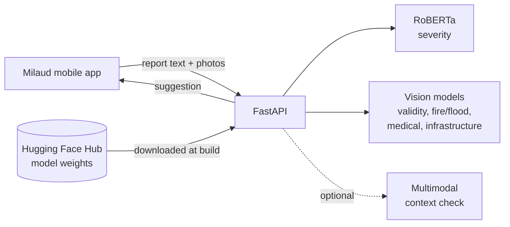

# Milaud ML Triage API

Machine learning API that triages citizen emergency reports for **[Milaud](https://github.com/Rksaycon/milaud-governance-platform)**, a digital governance platform for Milaor, Camarines Sur.

When a resident submits a report, this API suggests a **severity level** from the text and checks whether the attached **photos match the reported emergency**. Its output is always a suggestion: an administrator verifies every report, and the app never blocks a submission because of the AI.

<p>
  
  
  
  
  
</p>

## Models

I trained all five models. The weights are published at **[huggingface.co/reygann/mylaud-ml-models](https://huggingface.co/reygann/mylaud-ml-models)**.

| Model | Architecture | Task |
|---|---|---|
| Severity classifier | RoBERTa, fine-tuned | Classifies report text as High, Medium or Low |
| Photo validity | MobileNetV3-Small | Checks whether a photo shows a real incident scene |
| Fire / flood | MobileNetV3-Small | Distinguishes fire from flooding |
| Medical and road crash | EfficientNet-B0 | Detects medical emergencies and road accidents |
| Infrastructure damage | EfficientNet-B0 | Detects damaged roads, structures and utilities |

### Reducing false positives
Early versions flagged random photos (selfies, normal rivers, sunsets) as emergencies. I improved this over several retraining rounds:

- Raised the disaster-confidence threshold from 55% to 80% to 90%
- Added a face-detection filter so portraits aren't classified as fire or flood because of their colors or lighting
- Replaced a mislabeled validity model that was marking real floods as invalid
- Calibrated decision thresholds for the medical and infrastructure detectors, with a separate, stricter threshold before the app may auto-select a category
- Added an optional multimodal check that looks at up to three photos together to catch look-alikes such as controlled burning or a person resting

## API endpoints

| Method | Endpoint | Description |
|---|---|---|
| `GET` | `/health` | Health check |
| `POST` | `/classify` | Severity for one report's text |
| `POST` | `/classify/batch` | Severity for several reports |
| `POST` | `/classify/explain` | Severity with an explanation of the result |
| `POST` | `/verify-image` | Detects what a photo shows and flags a mismatch with the reported category |
| `POST` | `/verify-incident` | Checks 1–3 photos together as one incident |
| `GET` | `/weather/rain-risk` | Current rain-based flood risk for a location |
| `POST` | `/notify-high` | Emails officials about a High-severity report |

Interactive docs are available at `/docs` when the server is running.

### Example
```bash
curl -X POST http://localhost:7860/classify \
  -H "Content-Type: application/json" \
  -d '{"report_text": "Water is rising fast near the bridge, families are trapped", "category": "Flooding"}'
```

## How it works



The model weights aren't stored in this repo. At build time, `model_artifacts.py` downloads a **pinned version** of the weights from Hugging Face Hub, so every deployment uses the exact same models.

## Run locally

### With Docker
```bash
docker build -t milaud-ml-triage-api .
docker run -p 7860:7860 --env-file .env milaud-ml-triage-api
```

### Without Docker
```bash
python -m venv venv
venv\Scripts\activate          # Windows  (macOS/Linux: source venv/bin/activate)
pip install -r requirements.txt
uvicorn api:app --host 0.0.0.0 --port 7860
```

Then open http://localhost:7860/docs.

### Configuration
Copy `.env.example` to `.env`. Every setting is optional, and the API still runs without them:

| Variable | Purpose |
|---|---|
| `OPENAI_API_KEY` | Enables the multimodal incident context check |
| `RESEND_API_KEY` | Enables email alerts |
| `ALERT_RECIPIENTS` | Comma-separated list of alert email addresses |
| `OPENWEATHER_API_KEY` | Enables the rain-risk endpoint |

## Deployment

The API is deployed as a **Docker Space on Hugging Face** (port 7860, non-root user, as Spaces require). The Space is hosted on a teammate's account.

## Project files

| File | Purpose |
|---|---|
| `api.py` | FastAPI app and endpoints |
| `vision_classifier.py` | Loads the image models and combines their results |
| `context_verifier.py` | Optional multimodal incident check |
| `model_artifacts.py` | Downloads the pinned model weights from Hugging Face Hub |
| `Dockerfile` | Container build for Hugging Face Spaces |

## My role

**Reygann Saycon** (Rksaycon) · [GitHub](https://github.com/Rksaycon) · [Hugging Face](https://huggingface.co/reygann)

I created Milaud: the original idea, the system design, and all of the machine learning. I trained the five models, improved them over several retraining rounds, and built this API. The mobile and web interfaces were built with my team as part of our capstone project for the Municipality of Milaor. The API runs on a teammate's Hugging Face Space.
